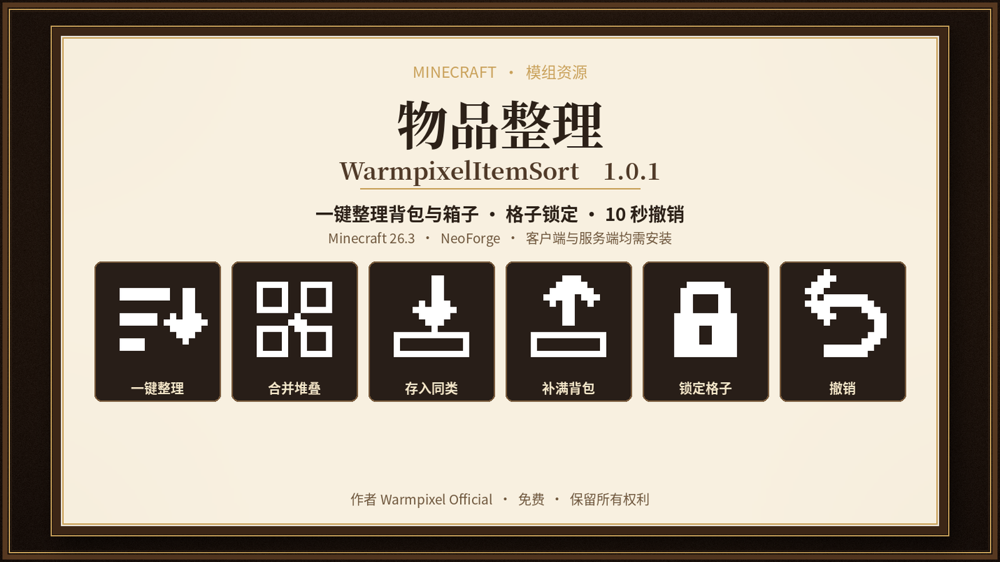
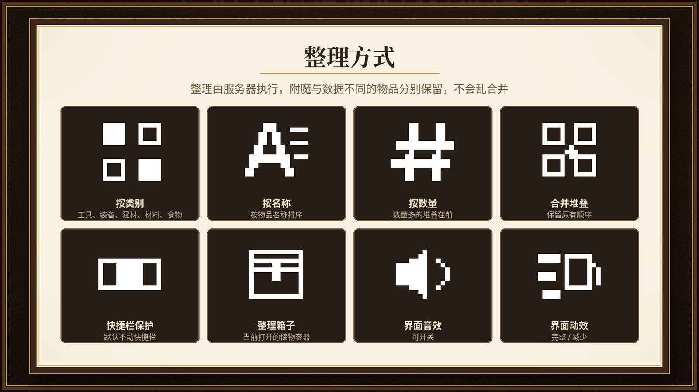
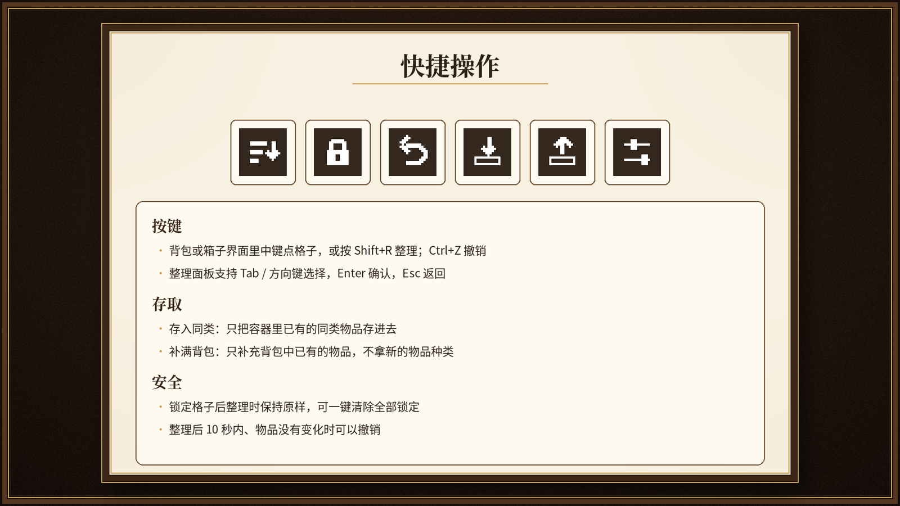

# 物品整理 WarmpixelItemSort

背包和箱子一键整理，支持格子锁定、存入同类、补满背包和 10 秒撤销，整理由服务器执行更安全。

- Minecraft：26.3
- 加载器：NeoForge 26.3.0.23-beta 或更高
- 客户端与服务端都需要安装
- 无其他模组前置
- 语言：简体中文 / English

## 截图 Screenshots

## 下载

请到 [Releases](../../releases) 页面下载 jar（版本 1.0.1）。

## 内容

- 一键整理自己的背包或当前打开的储物容器（默认保留快捷栏）
- 整理方式：按类别（工具、装备、建材、材料、食物等）、按名称、按数量、只合并堆叠
- 附魔与数据不同的物品分别保留，不会乱合并
- 存入同类：只把容器里已有的同类物品存进去；补满背包：只补充已有物品
- 锁定格子，整理时保持原样，可一键清除全部锁定
- 整理后 10 秒内、物品没有变化时可撤销
- 快捷键：中键点格子或 Shift+R 整理，Ctrl+Z 撤销；界面音效与动效可调

## 说明

- 本仓库只用于发布 jar，不含源码。

作者：Warmpixel Official ｜ 许可：All Rights Reserved（保留所有权利）

## 🏡 暖像素 WarmPix 服务器

本模组正在 **暖像素 WarmPix** 服务器上使用，欢迎来服里实际体验。

暖像素 WarmPix 是新开的 Java 26.3 NeoForge 模组生存服，公益服无付费内容，多线、无白名单，正版/离线账号都能进。新服招人开荒，长期稳定运营、永久不跑路。

- 服务器地址：`minecraft.warmpix.com`
- 官网：https://warmpix.com/
- 宣传片：https://www.bilibili.com/video/BV1NhWh6dEcu/
- QQ 群：**705556278**

扫码或搜索群号 705556278 加入 QQ 群。
